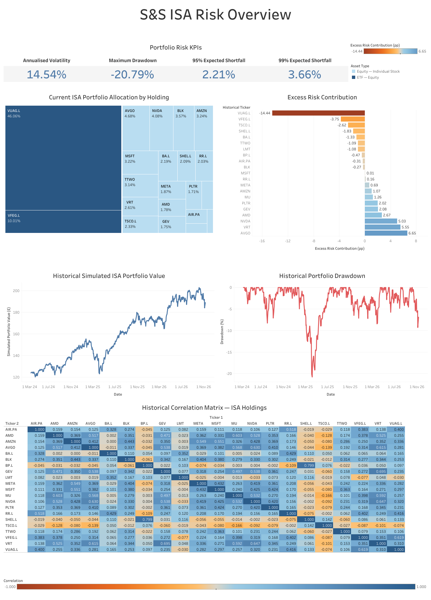
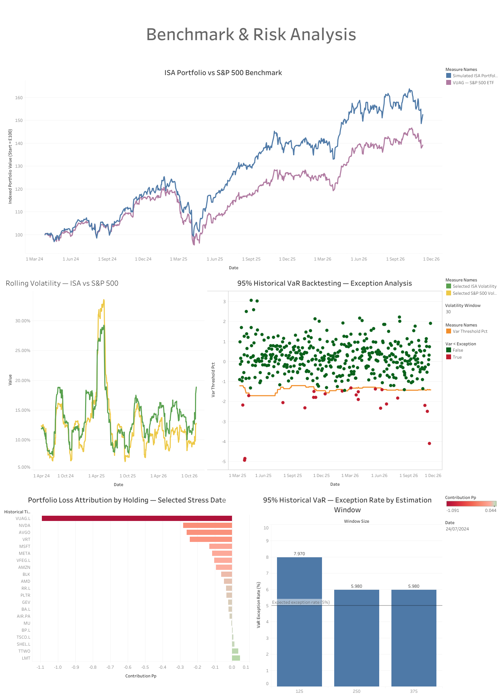

# Quantitative Market Risk Assessment — Stocks & Shares ISA

**Python | pandas | Google BigQuery SQL | Tableau Public**

## About the Project

I started this project as part of my data analytics capstone, using my own Trading 212 Stocks & Shares ISA portfolio.

I've been investing since I was 18, but had never properly analysed the risk in my portfolio. I wanted to use what I'd learned from my data analytics course and mathematics degree to understand where my portfolio's risk comes from and how it compares with a simple S&P 500 investment.

My portfolio contains 21 instruments, including two ETFs and 19 individual stocks. Some of these stocks are already included in the ETFs, so I was particularly interested in understanding whether the additional exposure was worthwhile.

The analysis uses historical market data from **March 2024 to November 2026**.

*The portfolio's historical performance is simulated using my current holdings and is not a record of my actual investment returns.*

## Tableau Dashboards

I built two interactive dashboards to present the results.

### 1. ISA Market Risk Overview

This dashboard looks at the portfolio itself, including asset allocation, risk contributions, historical performance, drawdowns and correlations.



### 2. Benchmark & Risk Analysis

This dashboard compares the portfolio with the S&P 500 and explores rolling volatility, VaR backtesting, historical stress losses and model sensitivity.



**[View the interactive dashboards on Tableau Public](https://public.tableau.com/app/profile/jan.b7461/viz/ISAPortfolioMarketRiskAnalysis/Dashboard1)**

## Key Results

| Metric | Result |
|---|---:|
| Holdings analysed | 21 |
| Simulated portfolio return | +52.51% |
| S&P 500 benchmark return | +39.20% |
| Annualised portfolio volatility | 14.54% |
| Maximum drawdown | −20.79% |
| 95% daily Value at Risk | 1.39% |
| 95% Expected Shortfall | 2.21% |
| VaR backtesting exceptions | 23 out of 426 (5.40%) |

The simulated portfolio returned 13.31 percentage points more than the benchmark over the period, although it also experienced higher volatility.

One of the more interesting findings was that some individual stocks contributed much more to portfolio risk than their allocation suggested, particularly technology-related holdings.

The VaR backtesting also showed how the choice of historical estimation window affected the model's results.

My full interpretation of these findings is available in the [Project Summary](PROJECT_SUMMARY.md).

## How I Completed the Analysis

| Tool | What I used it for |
|---|---|
| Python and pandas | Downloading and preparing historical prices and exchange rates |
| Google BigQuery SQL | Cleaning data, constructing the portfolio and calculating financial risk |
| Tableau Public | Building interactive dashboards to explore and present the results |

### Data Preparation

I used Yahoo Finance to collect historical stock prices and exchange rates.

There were several issues to resolve before analysing the portfolio:

- **Different currencies:** Converted USD, EUR and GBX prices into GBP.
- **Missing FX data:** Found a missing exchange rate and supplemented it using verified historical data from another online source.
- **Different trading calendars:** Aligned prices across exchanges and forward-filled missing observations.
- **Incomplete price histories:** Restricted the analysis to the period where all 21 instruments had available price history.

### Financial Analysis

The SQL analysis covers portfolio returns, volatility, drawdowns, correlations, risk contributions, Value at Risk, Expected Shortfall, benchmark comparisons, rolling volatility, backtesting and stress testing.

The calculations and methodology are available in the `sql/` folder and the [Analysis Methods](docs/04_analysis_methods.md) document.

## Repository Structure

```text
├── assets/           # Dashboard screenshots and project poster
├── data/             # Data documentation and summary results
├── docs/             # Project methodology and detailed findings
├── reports/          # Additional technical analysis
├── sql/              # BigQuery SQL queries
├── src/              # Python scripts
├── tests/            # Data validation tests
├── PROJECT_SUMMARY.md
├── README.md
```

## Project Documentation

For more information about the project:

- [Project Summary](isa-market-risk-case-study/PROJECT_SUMMARY.md) — Background, findings and what I learned
- [Research Objectives](isa-market-risk-case-study/docs/01_business_task.md) — Why I chose the project
- [Data Sources](isa-market-risk-case-study/docs/02_data_sources.md) — Where the data came from
- [Data Cleaning](isa-market-risk-case-study/docs/03_data_cleaning_log.md) — Issues encountered and how I handled them
- [Analysis Methods](isa-market-risk-case-study/docs/04_analysis_methods.md) — Statistical methods and calculations
- [Dashboard Design](isa-market-risk-case-study/docs/05_dashboard_design.md) — Tableau visualisations and design choices
- [Conclusions](isa-market-risk-case-study/docs/06_conclusions.md) — Interpretation and further research

## Running the Project

Install the Python dependencies using:

```bash
pip install -r requirements.txt
```

The Python scripts and BigQuery SQL queries are available in their respective folders. The data preparation and calculations are documented alongside the code.

The original market data and personal holding quantities are not included in the public repository.

## Further Research

There are three areas I would like to investigate further:

- **Sector exposure:** Understanding the combined sector allocation of my ETFs and individual stocks.
- **Return attribution:** Identifying which holdings contributed most to the portfolio's additional historical returns.
- **April 2025 drawdown:** Investigating the market conditions behind the largest portfolio decline.

These would help me build a better understanding of the relationship between my portfolio's historical performance and its risk.

---

*This is an educational financial risk analysis using a hypothetical historical portfolio. The results are not investment recommendations or a record of realised account performance.*
